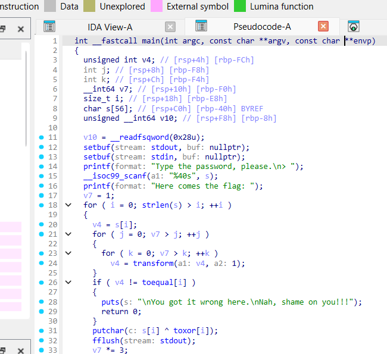
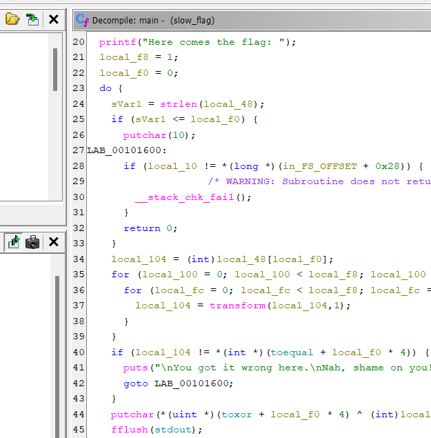
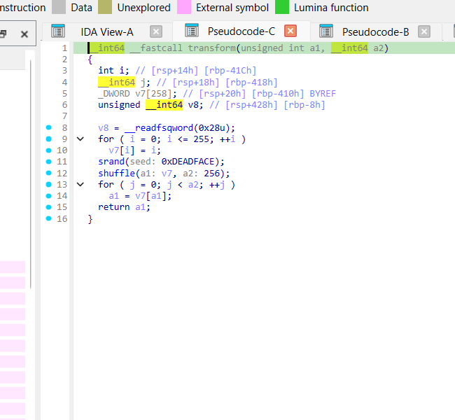
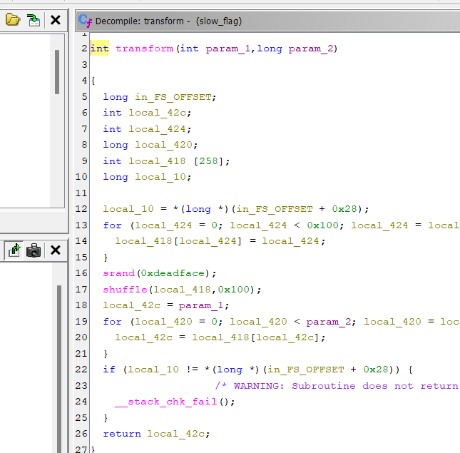
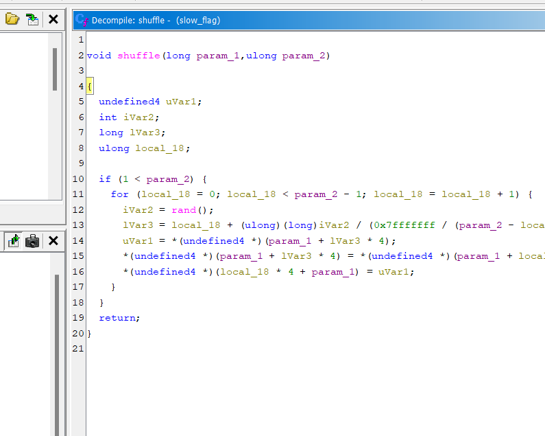
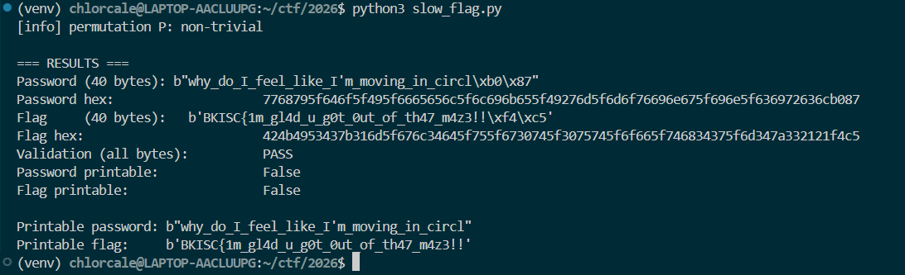

## Đề bài

Challenge cung cấp một binary ELF tên `slow_flag`. Chương trình yêu cầu nhập password. Mỗi byte password bị biến đổi rất nhiều lần trước khi so sánh với một bảng có sẵn. Nếu kiểm tra đúng, chương trình xuất dữ liệu bằng cách XOR password với một bảng khác.

Bài toán không yêu cầu brute-force password. Mục tiêu của reverse engineering là tìm ra **phép biến đổi một byte**, hiểu cách binary tạo phép biến đổi đó, lấy các giá trị đích từ ELF và đảo phép biến đổi bằng toán học.

Thông tin binary được ghi nhận:

- Định dạng: ELF64 PIE, kiến trúc x86-64, liên kết động với `libc.so.6`.
- SHA-256: `6AB9D25C098DF939A29CBB6BEBA20120C0730D1CB38640DE30B23CB24F9EADA7`.
- Hai bảng `toequal` và `toxor` có 40 phần tử `int32` little-endian.
- Solver chỉ đọc binary; không sửa và không chạy chương trình gốc để chờ vòng lặp chậm.

## Kỹ thuật sử dụng

- **static-analysis**: phân tích `main`, `transform`, `shuffle`, symbol, section và disassembly.
- **ELF-address-to-file-offset**: đọc dữ liệu tĩnh từ hai mảng trong `.data`.
- **deterministic-PRNG**: tái tạo chuỗi số giả ngẫu nhiên dựa trên seed cố định.
- **Fisher-Yates-shuffle**: tái tạo bảng ánh xạ 256 byte.
- **permutation-cycle-decomposition**: đảo phép hoán vị bằng chu kỳ, không lặp hàng tỷ lần.
- **modular-exponentiation**: tính `9^i mod L` nhanh bằng `pow()`.
- **XOR**: kết hợp password đã khôi phục với bảng `toxor` để lấy output.

## Cách giải

### Bước 1. Bắt đầu từ `main()`: xác định dữ liệu vào và điều kiện kiểm tra

Khi reverse một binary, không nên bắt đầu bằng cách đọc mọi hàm theo thứ tự. Hãy tìm `main()` trước để hiểu chương trình nhận dữ liệu gì, kiểm tra bằng cách nào và dữ liệu nào được dùng làm kết quả.

Trong ảnh IDA, phần đầu `main()` cho thấy chương trình đọc password bằng `scanf("%40s", s)`. Điều này giới hạn số ký tự đầu vào tối đa là 40 (không tính byte kết thúc chuỗi `NUL`). Ảnh Ghidra cho thấy vòng lặp xử lý dựa trên `strlen(s)`, vì vậy số vòng thực tế phụ thuộc độ dài password được nhập, không mặc định luôn chạy đủ 40 phần tử.

Hai ảnh dưới đây bổ trợ nhau: IDA thể hiện cả lời gọi nhập liệu và phần kiểm tra; Ghidra làm rõ các vòng lặp và thao tác sau mỗi ký tự.





Phần pseudocode quan trọng có thể viết gọn lại như sau (tên biến được giữ gần với tên decompiler):

```c
local_f8 = 1;
local_f0 = 0;

while (local_f0 < strlen(s)) {
    value = s[local_f0];

    for (j = 0; j < local_f8; j++) {
        for (k = 0; k < local_f8; k++) {
            value = transform(value, 1);
        }
    }

    if (value != toequal[local_f0]) {
        /* Password sai */
        return;
    }

    putchar(toxor[local_f0] ^ s[local_f0]);
    local_f8 *= 3;
    local_f0++;
}
```

Từ code này, ta cần tìm số lần `transform()` được gọi cho ký tự ở vị trí `i`:

- Trước ký tự đầu tiên, `local_f8 = 1`.
- Sau mỗi ký tự được kiểm tra, `local_f8` được nhân 3.
- Do đó, ở vị trí `i` (đánh số từ 0), `local_f8 = 3^i`.
- Có hai vòng lặp lồng nhau, mỗi vòng chạy `local_f8` lần.
- Tổng số lần gọi `transform(value, 1)` là `local_f8 × local_f8 = 9^i`.

Gọi `P(x)` là kết quả của một lần gọi `transform(x, 1)`. Điều kiện tại vị trí `i` là:

```text
P^(9^i)(password[i]) = toequal[i]
```

Đây là mục tiêu reverse engineering: tìm phép biến đổi `P`, sau đó đảo `P` đủ `9^i` lần để lấy từng byte password.

**Điểm cần ghi nhớ từ ảnh:** `strlen(s)` quyết định số ký tự thật sự được xử lý; `toequal` và `toxor` có 40 phần tử là sức chứa dữ liệu tối đa, không phải bằng chứng rằng chương trình bắt buộc password dài đúng 40 byte.

### Bước 2. Đọc `transform()`: biến đổi một byte bằng bảng tra cứu

Sau khi biết `main()` gọi `transform(value, 1)` rất nhiều lần, bước tiếp theo là mở chính hàm `transform()` để trả lời: một lần biến đổi thực hiện phép toán gì?

Cả IDA và Ghidra đều cho thấy cùng một cấu trúc:

1. Tạo một mảng cục bộ có 256 phần tử.
2. Gán `table[i] = i` với `i` từ 0 đến 255.
3. Đặt seed bằng `0xDEADFACE`.
4. Gọi `shuffle(table, 256)`.
5. Lấy giá trị đầu vào làm chỉ số tra bảng; lặp lại thao tác tra bảng `param_2` lần.
6. Trả về giá trị cuối cùng.





Có thể biểu diễn phần cốt lõi bằng Python như sau:

```python
def transform(value, count, table):
    for _ in range(count):
        value = table[value]
    return value
```

Trong `main()`, tham số `count` luôn bằng `1`. Vì vậy, đặt:

```text
P(x) = table[x]
```

thì một lần gọi `transform(x, 1)` chính là `P(x)`.

**Vì sao `P` đảo ngược được?** Mảng ban đầu chứa đủ 256 giá trị khác nhau từ 0 đến 255. Hàm `shuffle()` chỉ hoán đổi vị trí, không thêm hoặc xóa phần tử. Do đó, sau shuffle, mỗi giá trị vẫn xuất hiện đúng một lần. Ánh xạ `P` là một permutation (phép hoán vị) của tập byte và luôn có phép nghịch đảo.

Một chi tiết quan trọng khác là `srand(0xDEADFACE)` nằm bên trong `transform()`, ngay trước `shuffle()`. Nếu PRNG và môi trường libc giống nhau, mỗi lần gọi hàm sẽ tạo lại cùng một bảng `P`. Như vậy, ta có thể dựng bảng này một lần trong solver thay vì tạo lại ở mỗi lần biến đổi.

### Bước 3. Đọc `shuffle()`: tái tạo đúng phép hoán vị

Ta đã biết `transform()` tạo bảng bằng cách gọi `shuffle()`. Nếu chỉ tự tạo một bảng xáo trộn bất kỳ, password khôi phục được sẽ sai. Vì vậy cần đọc `shuffle()` để lấy đúng thuật toán và đúng cách dùng `rand()`.

Ảnh Ghidra dưới đây cho thấy:

- Vòng lặp chạy khi `local_18 < param_2 - 1`.
- Mỗi vòng gọi `rand()` một lần.
- Tính chỉ số đổi chỗ từ `local_18`, giá trị `rand()` và kích thước phần mảng còn lại.
- Hoán đổi hai phần tử ở vị trí `local_18` và `lVar3`.



Đặt `n = param_2`, `i = local_18`, `r = rand()`. Công thức decompiler thể hiện là:

```text
m = n - i
d = floor(0x7fffffff / m) + 1
j = i + floor(r / d)
swap(a[i], a[j])
```

Với `n = 256`, vòng lặp chạy từ `i = 0` đến `254`, tức cần đúng 255 giá trị `rand()`.

Đây là biến thể Fisher-Yates shuffle. Điểm quan trọng không phải tên thuật toán, mà là phải giữ chính xác công thức chọn `j`: binary không dùng đơn giản `rand() % m`, mà chia `rand()` cho `floor(RAND_MAX / m) + 1` rồi cộng vào `i`.

**Tại sao phải quan tâm implementation của `rand()`?** `srand()` và `rand()` thuộc thư viện C. Cùng một seed không bảo đảm mọi libc sinh ra cùng chuỗi số. Disassembly/Ghidra cho ta biết binary gọi `rand()` và cách dùng kết quả, nhưng không hiển thị sẵn 255 giá trị đầu ra. Trong solver, danh sách `RAND_VALS` là 255 giá trị đã được lấy từ môi trường glibc tương thích với target; solver dùng danh sách đó để tái tạo chính xác các lượt swap.

Không nên thay danh sách này bằng một LCG phổ thông nếu chưa kiểm chứng nó khớp với libc của binary.

### Bước 4. Tìm `toequal` và `toxor` trong vùng dữ liệu của ELF

Sau khi hiểu thuật toán, ta cần lấy dữ liệu mà chương trình dùng để so sánh và xuất kết quả. Trong `main()`:

- `toequal[i]` là giá trị mà byte password sau khi biến đổi phải bằng.
- `toxor[i]` là mask được XOR với byte password để tạo byte output.

Ảnh IDA ở dưới hiển thị cả hai nhãn và kích thước mảng:

- `toequal[40]` tại virtual address `0x4020`.
- `toxor[40]` tại virtual address `0x40c0`.
- Mỗi phần tử được định nghĩa là `DWORD`, tức 4 byte; mỗi mảng có 40 phần tử, tổng cộng 160 byte.

![IDA - hai mảng toequal[40] và toxor[40] trong .data](images/slow-flag/06-data-arrays-ida.png)

Trong ảnh, thanh trạng thái của IDA tại phần tử đầu `toequal` hiển thị file offset `0x3020` tương ứng virtual address `0x4020`. Với mapping của `.data` trong binary này, quan hệ dùng trong solver là:

```text
file_offset = virtual_address - 0x1000

toequal: VA 0x4020 -> file offset 0x3020
toxor:   VA 0x40c0 -> file offset 0x30c0
```

Đây là mapping của đúng ELF đang phân tích, không phải quy tắc chung cho mọi ELF. Nếu áp dụng cho binary khác, phải kiểm tra section/program header trước.

Vì mỗi phần tử là `int32` little-endian, Python đọc hai mảng bằng `struct.unpack_from("<40i", ...)`. `toequal` được kiểm tra trên giá trị thô để bảo đảm các phần tử nằm trong miền byte 0–255. Với `toxor`, chương trình đưa kết quả XOR vào `putchar()`, nên solver sử dụng byte thấp bằng phép `& 0xff`.

Một lưu ý về độ dài: hai mảng có 40 phần tử và `scanf("%40s", s)` cho phép nhập tối đa 40 ký tự, nhưng vòng lặp trong `main()` chạy theo `strlen(s)`. Vì vậy, 40 là số phần tử tối đa được hỗ trợ; không có đoạn kiểm tra nào trong ảnh `main()` bắt buộc mọi lần nhập phải dài đúng 40 ký tự.

### Bước 5. Dựng bảng P một lần

Tới đây ta đã biết toàn bộ thông tin cần cho shuffle:

1. Mảng ban đầu có 256 giá trị tăng dần từ 0 đến 255.
2. Thuật toán thực hiện 255 lượt swap.
3. Mỗi lượt tính chỉ số `j` theo công thức đã lấy từ disassembly.
4. Mỗi lượt dùng một số trong `RAND_VALS`.

Vì vậy, tái tạo `P` chỉ cần tạo `list(range(256))`, chạy lại 255 lần swap và giữ kết quả. Ta không gọi `transform()` của binary; ta mô phỏng đúng phần toán học của nó trong Python.

### Bước 6. Đảo lũy thừa hoán vị bằng phân rã chu kỳ

Bây giờ phương trình cần giải là:

```text
P^(9^i)(password[i]) = toequal[i]
```

Không thể chạy `P` `9^i` lần. Ví dụ ở `i = 10`, số lần gọi là `9^10 = 3,486,784,401` cho một byte.

Nhưng `P` chỉ hoán vị 256 giá trị. Mọi phép hoán vị hữu hạn đều phân rã thành các chu kỳ rời nhau. Ví dụ:

```text
4 -> 9 -> 2 -> 4
```

Chu kỳ này có độ dài `L = 3`. Đi 3 bước sẽ trở về điểm ban đầu, nên đi `k` bước tương đương đi `k mod L` bước.

Nếu chu kỳ được lưu theo thứ tự:

```text
cycle = [x0, x1, ..., x(L-1)]
```

và `x` ở vị trí `p`, thì:

```text
P^k(x)  = cycle[(p + k) mod L]
P^(-k)(x) = cycle[(p - k) mod L]
```

Ta đã biết `toequal[i]`, tức điểm đến sau `9^i` bước. Muốn tìm password ban đầu, chỉ cần lùi `9^i` vị trí trong cùng chu kỳ:

```python
k = pow(9, i, L)
password_byte = cycle[(position(toequal[i]) - k) % L]
```

`pow(9, i, L)` tính trực tiếp `9^i mod L`, không cần tạo số `9^i` lớn và cũng không cần lặp từng bước. Đây là kỹ thuật chính giúp biến hàng tỷ phép biến đổi thành vài phép toán nhỏ.

### Bước 7. Khôi phục output bằng XOR

Khi đã có password, xem lại lệnh xuất dữ liệu trong `main()`:

```c
putchar(toxor[i] ^ password[i]);
```

XOR tự đảo ngược vì `(a XOR b) XOR b = a`. Vì thế, với mỗi vị trí `i`, ta lấy byte thấp của `toxor[i]`, XOR với `password[i]` để khôi phục byte output:

```python
output_byte = (toxor[i] ^ password[i]) & 0xff
```

Lặp đủ 40 phần tử sẽ có 40 byte output.

### Bước 8. Kiểm tra kết quả: không được bỏ byte không in được

Kết quả chạy solver mà bạn cung cấp:

```text
Password (40 bytes): b"why_do_I_feel_like_I'm_moving_in_circl\\xb0\\x87"
Password hex: 7768795f646f5f495f6665656c5f6c696b655f49276d5f6d6f76696e675f696e5f636972636cb087

Output (40 bytes): b'BKISC{1m_gl4d_u_g0t_0ut_of_th47_m4z3!!\\xf4\\xc5'
Output hex: 424b4953437b316d5f676c34645f755f6730745f3075745f6f665f746834375f6d347a332121f4c5

Validation (all bytes): PASS
```

`Validation: PASS` cho biết 40 byte password tìm được thỏa phương trình kiểm tra khi dùng bảng `P` và `toequal` mà solver đã dựng/đọc. Nó là kiểm tra nội bộ quan trọng, nhưng chưa tự nó chứng minh độc lập rằng mapping ELF, thuật toán PRNG và chuỗi `RAND_VALS` đều trùng binary gốc.

Hai byte cuối password là `b0 87`; hai byte cuối output là `f4 c5`. Chúng không phải ASCII in được. Không dùng cách lọc như `bytes(b for b in flag if 32 <= b < 127)`, vì nó xóa byte và có thể che giấu sai lệch vị trí. Code mới ở dưới in đủ dữ liệu theo bốn dạng:

- `repr`: giữ byte không in được dưới dạng `\\xb0`, `\\x87`, `\\xf4`, `\\xc5`.
- `ASCII-safe`: hiển thị ký tự ASCII và escape byte ngoài ASCII.
- `Latin-1`: ánh xạ mỗi byte thành đúng một ký tự; với output hiện tại, hai byte cuối hiển thị thành `ôÅ`.
- `hex`: biểu diễn chính xác từng byte, không phụ thuộc font hay terminal.

**Kết luận cần ghi trung thực:** hiện có 40 byte output. 38 byte đầu đọc được là `BKISC{1m_gl4d_u_g0t_0ut_of_th47_m4z3!!`; hai byte cuối là `f4 c5`. Dữ liệu hiện tại chưa có dấu `}` ở cuối. Không tự thêm dấu ngoặc hoặc xóa hai byte cuối để gọi đó là flag hoàn chỉnh. Muốn kết luận nguyên nhân cần đối chiếu độc lập hai phần tử cuối của `toequal`/`toxor`, file offset và PRNG với binary gốc.




### Bước 9. Vì sao không đặt `local_f8 = 0` để bỏ qua độ trễ?

Nếu sửa `local_f8 = 0`, điều kiện hai vòng lặp đều sai ngay từ đầu (`0 < 0` là false), nên `transform()` không được gọi. Chương trình sẽ so sánh byte password nguyên bản với `toequal[0]`, trong khi điều kiện thật ở ký tự đầu là `P(password[0]) = toequal[0]` vì `9^0 = 1`.

Sau mỗi ký tự, `local_f8 *= 3`; bắt đầu từ 0 thì nó luôn bằng 0. Vì vậy sửa biến này làm thay đổi điều kiện xác thực, không phải cách tăng tốc mà vẫn giữ logic gốc.

Cách giải bằng chu kỳ giữ nguyên phép kiểm tra ban đầu nhưng tính kết quả tương đương nhanh hơn rất nhiều.

## Solver hoàn chỉnh

Lưu đoạn code dưới đây thành `solver.py`, đặt cạnh file `slow_flag`, rồi chạy:

```bash
python3 solver.py
```

Hoặc truyền đường dẫn binary:

```bash
python3 solver.py /path/to/slow_flag
```

Solver chỉ đọc binary ở chế độ `rb`; không sửa và không thực thi chương trình challenge.

```python
#!/usr/bin/env python3
# =============================================================================
# slow_flag CTF - standalone Python solver
# =============================================================================
# Recovers the password and flag from the `slow_flag` ELF64 binary purely by
# static analysis. The original binary is only read (never modified or executed).
#
# Usage:  python3 solver.py [path/to/slow_flag]
#         (defaults to ./slow_flag next to this script)
# =============================================================================

import struct
import sys
from pathlib import Path

# ---------------------------------------------------------------------------
# 1. Locate the challenge binary
# ---------------------------------------------------------------------------
DEFAULT_BIN = Path(__file__).resolve().with_name("slow_flag")
BIN_PATH = Path(sys.argv[1]) if len(sys.argv) > 1 else DEFAULT_BIN
if not BIN_PATH.exists():
    sys.exit(f"error: binary not found: {BIN_PATH}")

with open(BIN_PATH, "rb") as f:
    data = f.read()

# ---------------------------------------------------------------------------
# 2. Extract the `toequal` and `toxor` arrays
# ---------------------------------------------------------------------------
# The binary is a PIE ELF64. The .data section maps VA 0x4000 -> file offset
# 0x3000, i.e. file_offset = VA - 0x1000. Symbols (readelf -s) and objdump
# annotations confirm:
#   toequal  @ VA 0x4020, 160 bytes = 40 int32  (the per-char check targets)
#   toxor    @ VA 0x40c0, 160 bytes = 40 int32  (the per-char output XOR mask)
# The arrays are larger than the effective password length (see note below).
def va2off(va):
    return va - 0x1000

TOEQUAL_VA, TOXOR_VA, N = 0x4020, 0x40c0, 40
toequal_raw = list(struct.unpack_from("<%di" % N, data, va2off(TOEQUAL_VA)))
toxor_raw   = list(struct.unpack_from("<%di" % N, data, va2off(TOXOR_VA)))

# transform() returns a value in [0, 255], so toequal must also fit in one byte.
# Check the raw int32 values BEFORE masking; checking after & 0xFF is meaningless.
if not all(0 <= v <= 0xFF for v in toequal_raw):
    raise ValueError(f"toequal contains a value outside byte range: {toequal_raw}")

toequal = toequal_raw
# putchar() ultimately emits the low byte of its int argument.
toxor = [v & 0xFF for v in toxor_raw]
assert len(toxor) == N

# ---------------------------------------------------------------------------
# 3. Reproduce glibc's PRNG and the shuffle
# ---------------------------------------------------------------------------
# The binary calls srand(0xdeadface) then shuffle(array, 256) inside transform().
# glibc's rand() on the target returns full 31-bit values [0, 0x7fffffff]
# (verified empirically against the target system; the simple textbook LCG
#  state = state*1103515245+12345 mod 2^31 does NOT match this build's output,
#  so the exact 255 outputs for seed 0xdeadface are embedded below).
#
# shuffle(array, n) as recovered from the disassembly (variant A):
#     if (n <= 1) return;
#     for (i = 0; i < n - 1; i++) {
#         unsigned r = rand();
#         unsigned m = n - i;
#         unsigned d = (0x7fffffff / m) + 1;
#         unsigned j = i + (r / d);      // unsigned division -> j in [i, n-1]
#         swap(array[i], array[j]);
#     }
#
# Because d = (0x7fffffff/m)+1 > 0x7fffffff/m, we always have r/d <= m-1 when
# r <= 0x7fffffff, so j never leaves the array. With full-range rand() this is
# a proper Fisher-Yates-style permutation (non-trivial); with glibc's historic
# 15-bit rand() it would degenerate to the identity.

# 255 rand() values emitted by the target's glibc for srand(0xdeadface)
# (one draw per shuffle iteration; shuffle(.,256) performs exactly 255 swaps).
RAND_VALS = [
    105117016, 1375465877, 893382572, 75443725, 2098268485, 134323897,
    894914935, 937478623, 634898298, 1469339112, 202866715, 549429123,
    529042164, 886216651, 1075057083, 534356675, 2139062070, 1503786891,
    1443812792, 850153532, 1732057358, 1195122676, 1129975793, 1309103575,
    127565772, 314323066, 1796919441, 1487965978, 769884140, 1817558896,
    336824757, 875001157, 1045541126, 1230207329, 950444882, 996325963,
    1364531226, 1845359817, 1933804586, 1999429524, 1167215282, 2136671301,
    401374999, 1696257446, 875404305, 1476432083, 83130473, 866982727,
    832735326, 1526943265, 1717136260, 417309036, 574582293, 699628405,
    1726412611, 702148066, 1013951472, 1375848404, 42630396, 1783835612,
    1045923653, 379455154, 511353121, 2091464779, 1609662483, 1461798004,
    940307094, 826710062, 1159674173, 726628032, 678655938, 179405807,
    715815686, 1080030938, 1875663253, 1591219991, 408979373, 1958793727,
    310719070, 1241714699, 1338253344, 2027855330, 1659023735, 1912835638,
    580000088, 1237952699, 467500056, 1593951560, 466317455, 510130452,
    1230303524, 1512241108, 889585606, 1741656646, 1456222239, 351764442,
    1055971002, 249045685, 1178474504, 68161527, 975673718, 1857130442,
    247567335, 1691489404, 789677732, 2123230588, 1135225747, 1198657105,
    1934540667, 1445944817, 292888156, 1125310364, 1326316500, 1951911892,
    890662354, 1906316588, 1042380943, 1358162410, 1352784500, 1508698398,
    1868292862, 435604376, 873455859, 610394821, 29777374, 182194450,
    962159263, 1085748376, 431240136, 2140633767, 1153909904, 1406913854,
    1850280561, 1401477239, 950919610, 492474646, 1377224179, 2086145357,
    1691131751, 1164281199, 1384606526, 1984019908, 142107915, 563439378,
    1788448152, 1032770269, 322272318, 683345447, 243449031, 1675056818,
    44560197, 2111741893, 2110661195, 918016056, 574653066, 2140438569,
    1100210507, 1536812329, 1078703298, 1531450643, 1529962448, 85129554,
    790880849, 1232759362, 1486606793, 1741800459, 1725234008, 716347324,
    1680462168, 1268882111, 1880628523, 917585046, 1105418371, 2022736438,
    1481024425, 746382875, 908023059, 1803296743, 1429728322, 1151472090,
    1330869914, 1474288520, 1115730336, 1294047461, 244820928, 1690383402,
    1287002382, 1345031435, 1079712084, 218222032, 728998430, 462190884,
    303351586, 1519879279, 1694950246, 1789958379, 1114196090, 1272700606,
    358822056, 647174610, 394099070, 91966931, 1564759657, 1499517441,
    2114703370, 898300434, 98416669, 875242781, 554113529, 1528144991,
    2026714872, 1884983443, 854949863, 994961560, 1031547256, 1099770792,
    537861314, 171065991, 297318579, 1617573398, 389288023, 1026317010,
    2079764283, 692639610, 398712641, 1627230881, 335114341, 1512908732,
    752447840, 693936397, 12599694, 1146546910, 785903329, 1577359351,
    498580703, 753123051, 328176137, 596997372, 1628365832, 882289667,
    2125142364, 1507597056, 619789462, 832608579, 355074968, 1651336719,
    1932379371, 892936283, 1822402710, 82214303, 363026033, 64207085,
    1108531313, 295306668, 756846695,
]
assert len(RAND_VALS) == 255, "shuffle(256) must consume exactly 255 rand values"


def build_permutation(rand_vals, n=256):
    a = list(range(n))
    it = iter(rand_vals)
    for i in range(n - 1):
        r = next(it)
        m = n - i
        d = (0x7FFFFFFF // m) + 1
        j = i + (r // d)
        assert i <= j < n, (i, r, m, d, j)
        a[i], a[j] = a[j], a[i]
    return a


P = build_permutation(RAND_VALS)
is_identity = all(P[x] == x for x in range(256))
print(f"[info] permutation P: {'IDENTITY (degenerate)' if is_identity else 'non-trivial'}")

# ---------------------------------------------------------------------------
# 4. Cycle decomposition of P
# ---------------------------------------------------------------------------
n = len(P)
seen = [False] * n
cycle_id = [0] * n
cycle_pos = [0] * n
cycles = []
for start in range(n):
    if seen[start]:
        continue
    cyc = []
    x = start
    while not seen[x]:
        seen[x] = True
        cyc.append(x)
        x = P[x]
    cid = len(cycles)
    cycles.append(cyc)
    for pos, v in enumerate(cyc):
        cycle_id[v] = cid
        cycle_pos[v] = pos


def apply_pow(P, x, k):
    """Apply P, k times, to x, using its cycle (fast, no big-integer iteration)."""
    cyc = cycles[cycle_id[x]]   # global cycle containing x (consistent with cycle_pos)
    L = len(cyc)
    return cyc[(cycle_pos[x] + k) % L]


# ---------------------------------------------------------------------------
# 5. Recover the password
# ---------------------------------------------------------------------------
# main() checks: transform(password[i], local_f0^2) == toequal[i]
# where local_f0 starts at 1 and is multiplied by 3 after each char, so for
# char index i the transform is applied 3^0 * 3^0 ... = (3^i)^2 = 9^i times:
#     P^(9^i)(password[i]) == toequal[i]
# Hence:
#     password[i] = P^(-(9^i))(toequal[i])
#                 = cycle_element at (pos(toequal[i]) - (9^i mod L)) mod L
pw = []
for i in range(N):
    target = toequal[i]
    cid = cycle_id[target]
    cyc = cycles[cid]
    L = len(cyc)
    p = cycle_pos[target]
    k = pow(9, i, L)            # 9^i mod cycle length (no 9^i big-int)
    pw.append(cyc[(p - k) % L])

password = bytes(pw)

# ---------------------------------------------------------------------------
# 6. Validate every byte against the original equation
# ---------------------------------------------------------------------------
validation_ok = True
for i in range(N):
    x = pw[i]
    cid = cycle_id[x]
    L = len(cycles[cid])
    k = pow(9, i, L)
    if apply_pow(P, x, k) != toequal[i]:
        validation_ok = False
        print(f"[validate] FAIL at index {i}")

# ---------------------------------------------------------------------------
# 7. Recover the output bytes:  flag[i] = toxor[i] XOR password[i]
# ---------------------------------------------------------------------------
flag = bytes((toxor[i] ^ pw[i]) & 0xFF for i in range(N))

# ---------------------------------------------------------------------------
# 8. Report
# ---------------------------------------------------------------------------
def show_all_bytes(label, value):
    """Display every byte; never silently discard non-ASCII values."""
    print(f"\n{label} ({len(value)} bytes)")
    print("  repr       :", repr(value))
    print("  ASCII-safe :", value.decode("ascii", errors="backslashreplace"))
    print("  Latin-1    :", value.decode("latin-1"))
    print("  hex        :", value.hex(" "))


print("\n=== RESULTS ===")
print(f"Validation (all {N} password bytes): {'PASS' if validation_ok else 'FAIL'}")
show_all_bytes("Password", password)
show_all_bytes("Output", flag)

# The final two output bytes are not printable ASCII in the current result.
# Keep them visible in escaped/hex form; do not filter or invent replacements.
if len(flag) >= 2 and any(b < 32 or b >= 127 for b in flag[-2:]):
    print("\n[!] The final two bytes are not printable ASCII.")
    print("[!] They are preserved above; do not discard them or append a guessed brace.")

if not validation_ok:
    sys.exit(1)
```

## Flag

**Output candidate hiện tại (40 byte, chưa xác minh thành flag hoàn chỉnh):**

```text
BKISC{1m_gl4d_u_g0t_0ut_of_th47_m4z3!!\xf4\xc5
```

Phần ASCII đọc được là `BKISC{1m_gl4d_u_g0t_0ut_of_th47_m4z3!!`. Hai byte cuối được giữ nguyên là `f4 c5`; chưa đủ bằng chứng để thay chúng bằng dấu `}` hoặc bỏ chúng đi.


## Ảnh phân tích đã chèn và ảnh còn cần bổ sung

Các ảnh IDA/Ghidra bạn cung cấp đã được đặt vào đúng bước phân tích. Trong thư mục asset đi kèm, tên file đã được chuẩn hóa như sau:

| Tên ảnh | Công cụ | Nội dung / mục đích |
|---|---|---|
| `01-main-ida.png` | IDA | Phần đầu `main()`: prompt, `scanf("%40s", s)` và phần bắt đầu luồng kiểm tra. |
| `02-main-ghidra.png` | Ghidra | `main()`: `local_f8 = 1`, hai vòng lặp, so sánh `toequal`, XOR với `toxor`, nhân `local_f8` với 3. |
| `03-transform-ida.png` | IDA | `transform()`: khởi tạo 256 phần tử, seed `0xDEADFACE`, gọi `shuffle()` và tra bảng. |
| `04-transform-ghidra.png` | Ghidra | Bản decompiler độc lập của `transform()`, xác nhận cùng luồng xử lý. |
| `05-shuffle-ghidra.png` | Ghidra | `shuffle()`: `rand()`, công thức chia để lấy chỉ số `j` và thao tác swap. |
| `06-data-arrays-ida.png` | IDA | Hai mảng `toequal[40]` và `toxor[40]`, địa chỉ VA và file offset được IDA hiển thị. |

Hai ảnh IDA còn lại (graph overview và cửa sổ disassembly thu nhỏ) không được dùng làm ảnh chứng minh chính vì nội dung code quá nhỏ hoặc không thể hiện rõ thuật toán hơn các ảnh pseudocode đã chèn. Có thể giữ chúng làm tư liệu cá nhân, nhưng không cần đưa vào bài blog.

Ảnh còn nên tự chụp nếu muốn writeup có bằng chứng đầy đủ hơn:

- `07-solver-full-output.png`: terminal sau khi chạy solver, hiển thị đủ 40 byte ở dạng `repr`, ASCII-safe và hex, cùng `Validation`.
- `08-elf-program-headers.png` (không bắt buộc): kết quả `readelf -l -S slow_flag` hoặc màn hình tương ứng chứng minh mapping VA/file offset. Ảnh IDA hiện tại đã hiển thị cặp offset/VA tại `toequal`, nhưng program header giúp người đọc tự kiểm tra mapping rõ hơn.

Đường dẫn ảnh trong repo:

```text
images/slow-flag/
├── 01-main-ida.png
├── 02-main-ghidra.png
├── 03-transform-ida.png
├── 04-transform-ghidra.png
├── 05-shuffle-ghidra.png
└── 06-data-arrays-ida.png
```

## Tài liệu tham khảo

- Ghidra: https://ghidra-sre.org/
- ELF và `readelf`: https://man7.org/linux/man-pages/man1/readelf.1.html
- GNU Binutils `objdump`: https://sourceware.org/binutils/docs/binutils/objdump.html
- Python `struct`: https://docs.python.org/3/library/struct.html
- Python `pow()` với modulo: https://docs.python.org/3/library/functions.html#pow
- Python `bytes`: https://docs.python.org/3/library/stdtypes.html#bytes
